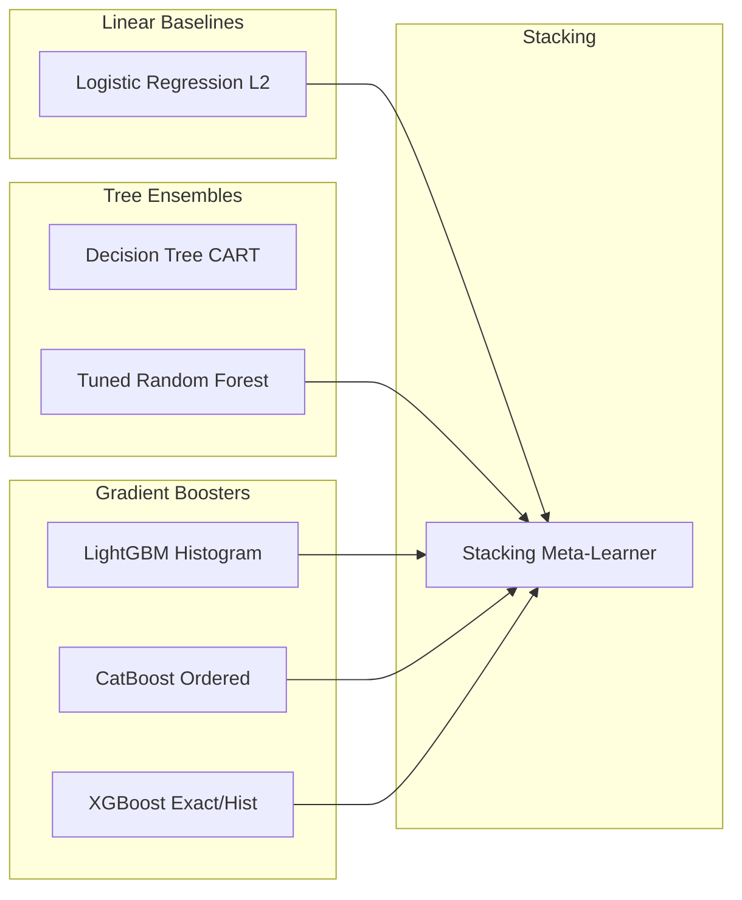

# Comprehensive Methodology & Techniques Reference Note
## AI-Powered Cardiovascular Risk Prediction & Digital Twin System

> **Document Purpose:** This reference note documents all data engineering, preprocessing, physiological feature formulations, machine learning architectures, statistical evaluation metrics, and explainability frameworks utilized in this project. It is structured specifically to serve as a direct reference for writing the **Methodology**, **Experimental Setup**, and **Results** sections of research papers, dissertations, and technical reports.

---

## 1. Dataset Profile & Clinical Scope

### 1.1 Dataset Summary
The study utilizes the **Cardiovascular Disease Dataset** comprising $N = 70,000$ patient clinical records. The target variable is binary:
$$\text{cardio} \in \{0, 1\}$$
where $0$ indicates absence and $1$ indicates clinical presence of cardiovascular disease (CVD). The raw dataset exhibits an almost exact 50.0% / 50.0% class balance ($34,979$ negative vs. $35,021$ positive cases).

### 1.2 Raw Feature Inventory

| Attribute Name | Variable Type | Measurement Unit | Domain / Possible Values | Clinical Role |
| :--- | :--- | :--- | :--- | :--- |
| `id` | Identifier | Integer | $0 \dots 99,999$ | Unique record index (Dropped) |
| `age` | Continuous | Days | $10,798 \dots 23,713$ days | Patient chronological age |
| `gender` | Categorical | Binary code | $1 = \text{Female}, 2 = \text{Male}$ | Biological sex |
| `height` | Continuous | Centimeters ($\text{cm}$) | $55 \dots 250\text{ cm}$ | Anthropometric stature |
| `weight` | Continuous | Kilograms ($\text{kg}$) | $10.0 \dots 200.0\text{ kg}$ | Patient body mass |
| `ap_hi` | Continuous | $\text{mmHg}$ | $-150 \dots 16,020\text{ mmHg}$ | Systolic arterial blood pressure |
| `ap_lo` | Continuous | $\text{mmHg}$ | $-70 \dots 11,000\text{ mmHg}$ | Diastolic arterial blood pressure |
| `cholesterol` | Ordinal | Class level | $1 = \text{Normal}, 2 = \text{Above Normal}, 3 = \text{Well Above Normal}$ | Total serum cholesterol level |
| `gluc` | Ordinal | Class level | $1 = \text{Normal}, 2 = \text{Above Normal}, 3 = \text{Well Above Normal}$ | Fasting blood glucose level |
| `smoke` | Binary | Indicator | $0 = \text{Non-smoker}, 1 = \text{Active smoker}$ | Tobacco use status |
| `alco` | Binary | Indicator | $0 = \text{Non-drinker}, 1 = \text{Alcohol consumer}$ | Alcohol consumption |
| `active` | Binary | Indicator | $0 = \text{Sedentary}, 1 = \text{Physically active}$ | Habitual physical activity |
| `cardio` | Binary (Target) | Indicator | $0 = \text{Absence}, 1 = \text{Presence}$ | Target cardiovascular diagnosis |

---

## 2. Data Cleansing & Quality Control Protocol

Raw clinical records contain measurement noise, human entry typographical errors, and scale discrepancies. Rather than simple indiscriminate sample deletion, the following multi-stage protocol is executed:

### 2.1 Sign Error Inversion
Negative systolic and diastolic blood pressure values caused by dash-notation data entry are corrected:
$$ap\_hi = |ap\_hi|, \quad ap\_lo = |ap\_lo|$$

### 2.2 Typographical Decimal / Scale Repair
During manual entry, missing decimal points produce 4-digit numbers (e.g. typing `1400` instead of `140.0`, or `1000` instead of `100.0`):
$$\text{If } 1000 \le ap\_hi \le 2500 \implies ap\_hi = \lfloor ap\_hi / 10 \rfloor$$
$$\text{If } 1000 \le ap\_lo \le 1600 \implies ap\_lo = \lfloor ap\_lo / 10 \rfloor$$

### 2.3 Inverted Blood Pressure Swapping
Clinical technicians occasionally record diastolic pressure in the systolic column and vice-versa (e.g., $ap\_hi = 80\text{ mmHg}, ap\_lo = 120\text{ mmHg}$). Rather than dropping these high-information samples, the values are swapped when both fall into physiologically valid blood pressure regimes:
$$\text{If } (ap\_hi < ap\_lo) \land (ap\_lo \ge 70) \land (ap\_hi \ge 40) \implies \text{Swap}(ap\_hi, ap\_lo)$$

### 2.4 Adult Physiological Plausibility Bounding
Samples outside physiologically survivable human ranges are filtered to remove non-human or pediatric artifacts:
- **Systolic Blood Pressure ($ap\_hi$):** $70 \le ap\_hi \le 240\text{ mmHg}$
- **Diastolic Blood Pressure ($ap\_lo$):** $40 \le ap\_lo \le 150\text{ mmHg}$
- **Hemodynamic Plausibility:** $ap\_hi > ap\_lo$ (strict inequality)
- **Stature / Height:** $135 \le \text{height} \le 215\text{ cm}$
- **Body Mass / Weight:** $35.0 \le \text{weight} \le 180.0\text{ kg}$

*Cohort Retention:* After cleansing, the dataset retains approximately **$68,800$ clean patient records** ($>98.2\%$ cohort preservation).

---

## 3. Physiological Feature Engineering & Rationale

Machine learning models, particularly tree-based algorithms, do not inherently calculate nonlinear physical ratios. We engineer domain-informed physiological features grounded in cardiovascular hemodynamics:

### 3.1 Age Standardization
$$\text{age\_years} = \frac{\text{age (days)}}{365.25}$$

### 3.2 Body Mass Index (BMI)
$$\text{BMI} = \frac{\text{weight (kg)}}{\left(\frac{\text{height (cm)}}{100}\right)^2}$$
*Clinical Rationale:* Stratifies obesity, an established independent etiology of cardiac remodeling, left ventricular hypertrophy, and atherogenesis.

### 3.3 Pulse Pressure (PP)
$$\text{PP} = ap\_hi - ap\_lo$$
*Clinical Rationale:* Reflects pulsatile hemodynamics and compliance of the large elastic arteries (aorta). Elevated pulse pressure ($>50\text{ mmHg}$) is a clinical surrogate for arterial stiffness and vascular aging.

### 3.4 Mean Arterial Pressure (MAP)
$$\text{MAP} = ap\_lo + \frac{ap\_hi - ap\_lo}{3.0} = \frac{2}{3} ap\_lo + \frac{1}{3} ap\_hi$$
*Clinical Rationale:* Quantifies steady-state organ perfusion pressure across the full cardiac cycle, accounting for the fact that diastole occupies approximately two-thirds of the cardiac cycle at resting heart rates.

### 3.5 Pulsatility Index (PI)
$$\text{PI} = \frac{\text{PP}}{ap\_hi} = \frac{ap\_hi - ap\_lo}{ap\_hi}$$
*Clinical Rationale:* Dimensionless ratio measuring the fraction of total systolic pressure dissipated as pulsatile wave energy. Highly predictive of small-vessel target-organ damage.

### 3.6 Body Surface Area (BSA)
Calculated via the validated **Mosteller formula**:
$$\text{BSA} = \sqrt{\frac{\text{height (cm)} \times \text{weight (kg)}}{3600}}$$
*Clinical Rationale:* In clinical cardiology, BSA is superior to BMI for indexing cardiac output, stroke volume, and left ventricular mass.

### 3.7 Metabolic Syndrome Risk Score
An integer risk score ($0 \dots 4$) formulated according to the National Cholesterol Education Program (NCEP ATP III) guidelines:
$$\text{MetS} = \mathbb{I}(\text{BMI} \ge 30) + \mathbb{I}(\text{gluc} > 1) + \mathbb{I}(\text{cholesterol} > 1) + \mathbb{I}(ap\_hi \ge 130)$$
where $\mathbb{I}(\cdot)$ is the indicator function.

### 3.8 Atherogenic Compound Risk
$$\text{Athero\_Risk} = \text{cholesterol} \times \text{gluc}$$
*Clinical Rationale:* Models the compounding endothelial damage inflicted by concurrent hypercholesterolemia and hyperglycemia.

### 3.9 Lifestyle Vulnerability Index
$$\text{Lifestyle\_Risk} = \text{smoke} \times (1 - \text{active}) \times \mathbb{I}(\text{age\_years} \ge 50)$$
*Clinical Rationale:* Identifies the highest-risk lifestyle demographic: sedentary older smokers.

### 3.10 AHA/ACC Hypertension Clinical Staging
Patients are categorized according to American Heart Association / American College of Cardiology guidelines:
- **Stage 0 (Normal):** $ap\_hi < 120 \land ap\_lo < 80$
- **Stage 1 (Elevated):** $120 \le ap\_hi < 130 \land ap\_lo < 80$
- **Stage 2 (Hypertension Stage 1):** $130 \le ap\_hi < 140 \lor 80 \le ap\_lo < 90$
- **Stage 3 (Hypertension Stage 2):** $ap\_hi \ge 140 \lor ap\_lo \ge 90$
- **Stage 4 (Hypertensive Crisis):** $ap\_hi > 180 \lor ap\_lo > 120$

---

## 4. Model Architectures & Algorithmic Foundations

To establish statistical validity and determine the optimal predictor, seven diverse architectures are evaluated:

### 4.1 Regularized Logistic Regression (Clinical Baseline)
Models the log-odds of cardiovascular risk as a linear combination of features:
$$\log\left(\frac{P(Y=1|X)}{1 - P(Y=1|X)}\right) = \beta_0 + \sum_{j=1}^p \beta_j X_j$$
- Continuous variables are standardized via `RobustScaler` (median-centered and scaled by interquartile range to resist residual vital sign skewness).
- Regularized using $L_2$ penalty: $\mathcal{L}_{\text{reg}} = \mathcal{L}_{\text{CE}} + \frac{1}{2C} \|\boldsymbol{\beta}\|_2^2$ with $C=1.0$.

### 4.2 Decision Tree Classifier (CART)
Recursive binary partitioning based on Gini Impurity:
$$I_G(t) = 1 - \sum_{k=0}^1 p(k|t)^2$$
- Constrained with `max_depth=6` and `min_samples_leaf=20` to prevent unpruned memorization and produce human-interpretable clinical decision rules.

### 4.3 Tuned Random Forest Classifier (Bagging Ensemble)
Ensemble of $B=100$ decorrelated decision trees built via bootstrap aggregation (bagging) and random subspace feature selection:
$$\hat{P}(Y=1|X) = \frac{1}{B} \sum_{b=1}^B P_b(Y=1|X)$$
- **Hyperparameter Grid Configuration:**
  - `n_estimators`: $100$
  - `max_depth`: $12$ (prevents leaf over-partitioning on noisy vitals)
  - `min_samples_split`: $5$
  - `min_samples_leaf`: $2$ (smooths boundary probability estimates)
  - `max_features`: `'sqrt'` ($\approx \sqrt{p}$ features sampled per node split)

### 4.4 LightGBM Classifier (Gradient Boosted Trees)
Employs **Gradient-Based One-Side Sampling (GOSS)** and **Exclusive Feature Bundling (EFB)** with leaf-wise (best-first) tree growth:
- Highly scalable on $N=70,000$ samples.
- **Parameters:** `num_leaves=45`, `max_depth=7`, `learning_rate=0.03`, `n_estimators=600`, `subsample=0.8`, `colsample_bytree=0.8`.

### 4.5 CatBoost Classifier (Categorical Boosting)
Implements **Ordered Boosting** to eliminate target leakage and permutation-based categorical feature combinations:
- Exceptional performance on heterogeneous tabular data containing discrete levels (`cholesterol`, `gluc`, `smoke`, `alco`, `active`, `gender`).
- **Parameters:** `iterations=600`, `depth=6`, `learning_rate=0.04`, `l2_leaf_reg=3.0`.

### 4.6 XGBoost Classifier (Extreme Gradient Boosting)
Optimizes a regularized objective function combining second-order Taylor expansion of the loss with tree complexity penalties:
$$\mathcal{L}^{(t)} \approx \sum_{i=1}^n \left[ g_i f_t(x_i) + \frac{1}{2} h_i f_t^2(x_i) \right] + \gamma T + \frac{1}{2} \lambda \sum_{j=1}^T w_j^2$$
- **Parameters:** `n_estimators=500`, `max_depth=6`, `learning_rate=0.03`, `subsample=0.8`, `colsample_bytree=0.8`, `gamma=0.1`.

### 4.7 Stacking Ensemble Meta-Learner
A two-tier heterogeneous ensemble:
- **Level-0 Base Learners:** Tuned Random Forest, LightGBM, CatBoost, and XGBoost.
- **Level-1 Meta-Learner:** Logistic Regression trained strictly on out-of-fold cross-validation probability predictions:
  $$\hat{y}_{\text{meta}} = \sigma\left(w_0 + w_1 \hat{p}_{\text{RF}} + w_2 \hat{p}_{\text{LGB}} + w_3 \hat{p}_{\text{CAT}} + w_4 \hat{p}_{\text{XGB}}\right)$$
- Dampens individual model inductive biases and optimizes global generalization error.

---

## 5. Validation Protocol & Metrics Formulation

### 5.1 Stratified 5-Fold Cross-Validation
To guarantee zero data leakage between training and validation:
- The cohort is partitioned into $K=5$ folds, each maintaining the 50/50 target ratio.
- In each fold, feature scaling and pipeline transformations are fitted solely on the $80\%$ training split and applied to the $20\%$ held-out validation split.
- Out-of-fold (OOF) predictions are concatenated to compute unbiased overall metrics.

### 5.2 Mathematical Formulation of Evaluation Metrics

| Metric | Formulation | Clinical & Analytical Meaning |
| :--- | :--- | :--- |
| **Accuracy** | $\frac{TP + TN}{TP + TN + FP + FN}$ | Overall proportion of correct diagnoses |
| **Precision (PPV)** | $\frac{TP}{TP + FP}$ | Positive Predictive Value; minimizes false alarms |
| **Recall / Sensitivity (TPR)** | $\frac{TP}{TP + FN}$ | True Positive Rate; critical to avoid missing true cardiac patients |
| **Specificity (TNR)** | $\frac{TN}{TN + FP}$ | True Negative Rate; correctly identifies non-diseased individuals |
| **F1-Score** | $2 \cdot \frac{\text{Precision} \cdot \text{Recall}}{\text{Precision} + \text{Recall}}$ | Harmonic mean of precision and recall |
| **AUC-ROC** | $\int_0^1 \text{TPR}(\text{FPR}^{-1}(t)) \, dt$ | Discriminative ability invariant to decision threshold |
| **PR-AUC (Avg Precision)** | $\sum_n (R_n - R_{n-1}) P_n$ | Area under Precision-Recall curve |
| **Matthews Correlation (MCC)** | $\frac{TP \times TN - FP \times FN}{\sqrt{(TP+FP)(TP+FN)(TN+FP)(TN+FN)}}$ | Balanced coefficient ranging $[-1, +1]$; robust to class shifts |
| **Brier Score** | $\frac{1}{N} \sum_{i=1}^N (\hat{p}_i - y_i)^2$ | Measures mean squared calibration error of probability outputs |
| **Inference Latency** | $\text{Time per } 1,000 \text{ predictions (ms)}$ | Operational feasibility for real-time Digital Twin interaction |

---

## 6. Explainable AI (XAI) Framework: TreeSHAP

To avoid "black-box" clinical resistance, individual predictions are explained using **Shapley Additive exPlanations (SHAP)** rooted in cooperative game theory.

### 6.1 Mathematical Formulation
For a prediction model $f(x)$, the local explanation model $g(z')$ is linear:
$$g(z') = \phi_0 + \sum_{j=1}^M \phi_j z_j'$$
where $\phi_0 = \mathbb{E}[f(X)]$ is the base value (expected population risk), and $\phi_j \in \mathbb{R}$ is the Shapley attribution value for feature $j$:
$$\phi_j(x) = \sum_{S \subseteq F \setminus \{j\}} \frac{|S|!(|F| - |S| - 1)!}{|F|!} \left[ f_x(S \cup \{j\}) - f_x(S) \right]$$

### 6.2 TreeSHAP Optimization
For tree ensembles (Random Forest, LightGBM, XGBoost, CatBoost), exact Shapley values are calculated in polynomial time:
$$\mathcal{O}\left(T \cdot L \cdot D^2\right)$$
where $T$ is the number of trees, $L$ is the maximum number of leaves, and $D$ is the maximum tree depth. This allows real-time execution in the web-based Digital Twin within milliseconds during user "what-if" simulations.

---

## 7. Digital Twin State Mapping Formulation

The predicted calibrated probability $P(\text{CVD})$ and SHAP attributions are mathematically mapped into the multi-parameter **3D Cardiac Digital Twin**:

1. **Simulated Resting Heart Rate (BPM):**
   $$\text{HR}_{\text{twin}} = 65 + \left(\hat{p}_{\text{risk}} \times 35\right) + \mathbb{I}(\text{active}=0) \times 6$$
2. **Vascular Arterial Constriction Factor:**
   $$\text{Constriction} = \min\left(1.0, \, \frac{ap\_hi - 90}{120}\right)$$
3. **Myocardial Stress / Color Transition ($0.0 \dots 1.0$):**
   $$\text{ColorIndex} = \hat{p}_{\text{calibrated}} \quad (\text{Healthy Cyan/Green} \rightarrow \text{Hypertensive Amber/Red})$$
4. **Arrhythmia Fluctuation Coefficient:**
   $$\sigma_{\text{flutter}} = \hat{p}_{\text{risk}}^2 \times 0.25$$

---

## 8. Summary Checklist for Paper & Report Writing

When composing your methodology and results sections, cite these exact configurations:
- [x] **Cohort Size:** $N = 70,000$ raw records, filtered to $\approx 68,800$ verified records.
- [x] **Data Cleansing Protocol:** Sign removal, 4-digit typo scale repair ($\div 10$), inverted BP swapping, adult biological plausibility bounds.
- [x] **Physiological Engineering:** BMI, Pulse Pressure, Mean Arterial Pressure, Pulsatility Index, Body Surface Area (Mosteller), Metabolic Syndrome Score (NCEP ATP III), Atherogenic Interaction, AHA Hypertension Classification.
- [x] **Benchmarked Models:** Logistic Regression ($L_2$), Decision Tree (CART), Tuned Random Forest (Bagging), LightGBM, CatBoost, XGBoost, and Stacking Meta-Learner.
- [x] **Cross-Validation:** 5-Fold Stratified Cross-Validation with isolated preprocessing pipelines per fold.
- [x] **Explainability:** Fast TreeSHAP computing local feature attribution waterfalls and global beeswarm importance.
- [x] **Automated Artifacts:** Metrics table CSV/Excel, ROC curves, PR curves, Confusion matrix grid, SHAP summary plots, and calibration reliability curves.
